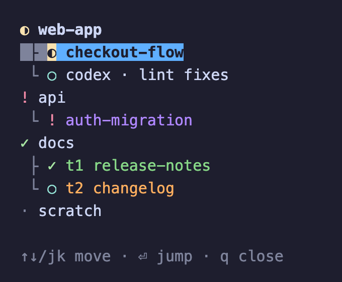

# herdr-space-sidebar

A [herdr](https://github.com/herdrdev/herdr) plugin that merges the Spaces and Agents panels into one list, with each agent nested under its space.



*The plugin's real output, shown with example data.*

Status symbols: `!` blocked, `✓` done, `◐` working, `○` idle, `·` nothing detected.

## Install

Requires herdr 0.9+ and `python3` on Linux or macOS. There is nothing to build.

```bash
herdr plugin install mashhoodr/herdr-space-sidebar
```

Bind a key in `~/.config/herdr/config.toml`, then run `herdr server reload-config`:

```toml
[[keys.command]]
key = "prefix+a"
type = "plugin_action"
command = "spaces-list.toggle"
description = "toggle spaces list"
```

To hide herdr's own sidebar, add the settings below and press `prefix+b`:

```toml
[ui]
sidebar_start_collapsed = true
sidebar_collapsed_mode = "hidden"
```

## Use

| Key | Action |
|---|---|
| `j` / `k` or arrows | Move |
| Enter or click | Jump to that agent or space |
| `q` or Esc | Close the list and keep it closed in this tab |
| `prefix+a` | Open, focus, or close the list |

- The list opens by itself when you move to a tab that doesn't have one, and focus stays on your work.
- The highlight follows the focused pane, except while the list itself has focus.
- Claude Code sessions show their `/rename` name and `/color`. These are read from Claude Code's internal files under `~/.claude`, so an update could change them; rows then fall back to the default text.

## Known limitations

- Closing a tab may not open the list in the tab you land on until you next switch to it.
- Closing the list with `prefix+x` brings it back on your next visit to that tab. Use `q` or the toggle instead.
- A tab whose left column is already split gives the list only the top slot.
- Switching tabs very quickly can leave one without a list until you next visit it.

## Develop

```bash
python3 -m unittest
herdr plugin link "$PWD"
```

Open lists keep running the old code until you close and reopen them.
